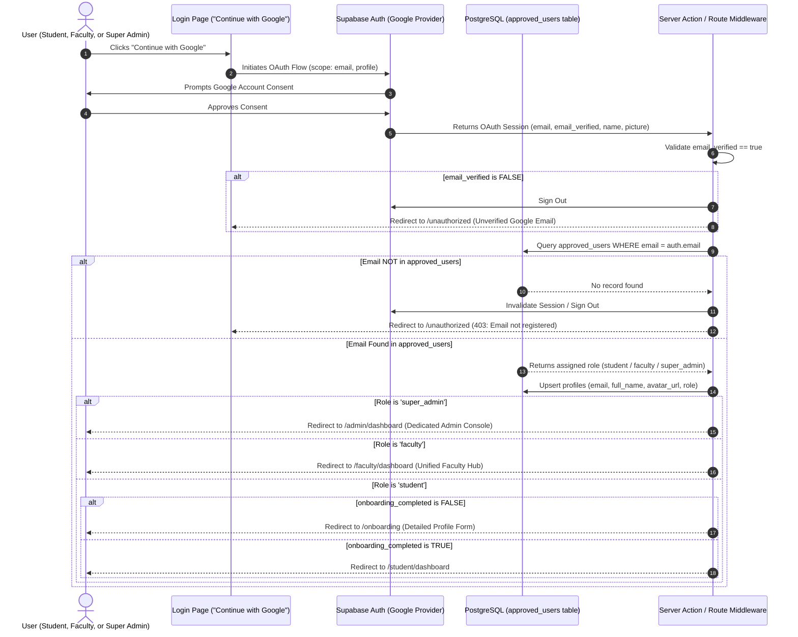

# Elite Track — Final System Architecture & Technical Blueprint (v3.3)
**Placement-Preparation Tracking Platform for Elite Pool (17 Students, 12 Faculty Members, Super Admin)**  
*Tagline: Track. Participate. Achieve.*

---

## 1. Executive Summary & Core Operational Principles

Elite Track is a placement-readiness tracking ecosystem developed for a specialized college cohort of **17 students**, **12 faculty members** (including Mentor Ganesh Sir, all Department HODs, Principal Sir, Dean R&D, and senior faculty), and administrative overseers.

### Core Architecture Principles:
1. **Unified Faculty Governance:** No hierarchical division between Mentor, Principal, or HODs. All 12 faculty members access the **exact same Faculty Dashboard** with identical permissions to monitor student progress, inspect platform statistics, review IST heatmaps, issue commands, inspect verified opportunities, generate consolidated Excel reports, and publish announcements. Designation does not dictate platform authorization.
2. **Dedicated Three-Tier Role Routing:** Server-side database authentication routes authenticated users to:
   - **Student:** $\to$ `/student/dashboard` (or `/onboarding` if incomplete).
   - **Faculty:** $\to$ `/faculty/dashboard` (Unified Faculty Dashboard for all 12 faculty members).
   - **Super Admin:** $\to$ `/admin/dashboard` (Dedicated administration console for allowlist management, global audit logs, and system health).
3. **Strict Allowlist-Gated Google OAuth & Verified Email Checks:** Authentication is strictly conducted via Supabase Google OAuth. Email accounts must be verified by Google (`email_verified = true`). Access is granted only if the authenticated Google email exists in the pre-registered `approved_users` database table. Unregistered emails are rejected immediately (403 Forbidden).
4. **Secure Initial Super Admin Provisioning:** The initial Super Admin account is deterministically seeded during database initialization via a secure server-side procedure using `INITIAL_SUPER_ADMIN_EMAIL`. Privileged service role keys and configuration secrets are strictly confined to the backend environment and **never exposed to frontend code**.
5. **Column-Level Security & Field Immutability:** Strict database triggers and RLS prevent students from tampering with protected fields:
   - Students cannot elevate their role, alter their email, change their roll number, modify platform metrics, tamper with verification statuses, overwrite faculty feedback, or mark their own contest participations as verified/winner.
   - Audit logs are append-only; updates and deletions are strictly blocked at the database engine level.
6. **Normalized Timestamp Architecture (Zero Redundancy):**
   - Submissions store a single UTC timestamp: `solved_at TIMESTAMPTZ NOT NULL`.
   - The IST calendar date is derived via an immutable stored generated column: `activity_date DATE GENERATED ALWAYS AS ((solved_at AT TIME ZONE 'Asia/Kolkata')::DATE) STORED`.
   - Redundant timestamps (`solved_at_utc` and `solved_at_ist`) are completely eliminated.
7. **Multi-Segment Coverage Windows & Strict Heatmap Logic:**
   - **GitHub Exclusion:** GitHub commits and pull requests are **strictly excluded** from accepted-problem coverage, activity state, and streak calculations.
   - **Active:** If *any* connected algorithmic platform confirms $\ge 1$ qualifying accepted problem on that calendar day.
   - **Inactive:** Assigned *only* when **ALL** connected algorithmic platforms have complete verified historical coverage for that date AND confirm zero qualifying accepted problems.
   - **Unknown / Pending Verification:** If no platform confirms activity and one or more connected platforms have incomplete coverage or pending backfills.
   - **In-Progress (Current Day):** The current calendar day in `Asia/Kolkata` IST remains `in_progress` until 23:59:59 IST; zero problems solved so far today does *not* break yesterday's streak.
   - **Streaks:** Unknown dates never prematurely break a streak. Streaks recalculate deterministically upon historical backfill completion.
8. **Idempotent Ingestion & Normalized Problem Equivalence:**
   - Ingestion stores `external_submission_id` with a database constraint on `(student_id, platform, external_submission_id)` to ensure repeated sync runs are strictly idempotent.
   - First accepted solve counting is enforced atomically inside an ingestion trigger using advisory locks; resubmissions award 0 points.
   - Cross-platform deduplication occurs strictly through normalized mappings in `problem_equivalences`.
9. **Instagram-Inspired Warm Glassmorphism UX:** Retains the high-craft visual identity: warm cream base (`#F6F1E9`), frosted translucent glass cards (15–25% opacity, backdrop blur 12–20px), petrol teal primary (`#1F4959`), terracotta (`#C9825B`) and amber (`#D9A441`) story-rings, serif headings (Playfair/Fraunces), and friendly human microcopy.

---

## 2. Updated User Roles & Permission Matrix

The application defines three mutually exclusive roles determined strictly by server-side database allowlist verification:

| Capability / Module | Student | Faculty (All 12 Members) | Super Admin |
| :--- | :---: | :---: | :---: |
| **Authentication Method** | Google OAuth (`email_verified=true`) | Google OAuth (`email_verified=true`) | Google OAuth (`email_verified=true`) |
| **Target Route** | `/student/dashboard` | `/faculty/dashboard` | `/admin/dashboard` |
| **Onboarding Form Required** | **Yes** (Detailed Academic/Coding Profile) | **No** (Auto-populated from Google) | **No** (Pre-seeded) |
| **View 17-Student Cohort Grid** | No (Strict student isolation via RLS) | **Yes** (Full batch visibility) | **Yes** |
| **View Individual Coding Progress** | Own progress only | **Yes** (Any of the 17 students) | **Yes** |
| **View Platform Stats & Sync Badges** | Own badges only | **Yes** (All students & platforms) | **Yes** |
| **View Heatmaps & Streaks** | Own IST heatmap only | **Yes** (All 17 students' IST heatmaps) | **Yes** |
| **View Monitoring Leaderboards** | Read snapshot (if faculty enables) | **Yes** (All 5 leaderboards & scoring details) | **Yes** |
| **Issue Commands (All / Individual / Selected)**| No | **Yes** (Assign tasks, attachments, deadlines)| **Yes** |
| **Respond to Commands (Submit/Comment)**| **Yes** (Update status, add links/comments)| No (Reviews and gives feedback) | No |
| **Threaded Discussion on Commands** | **Yes** (On own assigned commands) | **Yes** (On any command assignment) | **Yes** |
| **Opportunity Verification Pipeline** | View `Approved` opportunities only | **Yes** (Review, verify, approve, reject) | **Yes** |
| **Track Contest/Hackathon Participation**| **Yes** (Log participation, upload proofs) | **Yes** (Review & verify student proofs)| **Yes** |
| **Download Excel Reports** | Download own dossier | **Yes** (Individual dossiers + Consolidated Batch) | **Yes** |
| **Broadcast Announcements (In-App + WhatsApp)**| Receive notifications | **Yes** (Broadcast to cohort or individuals) | **Yes** |
| **Manage User Allowlist & Roles** | No | No | **Yes** (Manage `approved_users`) |
| **Inspect System & Audit Logs** | No | No | **Yes** (Full audit trail & export history) |

*Faculty Parity Guarantee:* Designation (Mentor Ganesh Sir, Principal Sir, Dean R&D, HOD CSE, HOD AI&DS, HOD IT, Professors) carries equal authorization across the faculty portal.

---

## 3. Dedicated Three-Tier Google OAuth Authentication Flow



### Initial Faculty Allowlist Pre-Registration
The initial deployment seeds the following **9 verified faculty addresses** (no placeholder addresses added):
1. `ganesh@uniqshift.com` (Mentor)
2. `principal@nec.edu.in` (Principal Sir)
3. `deanrd@nec.edu.in` (Dean R&D)
4. `hodcse@nec.edu.in` (HOD Computer Science & Engineering)
5. `hodai@nec.edu.in` (HOD Artificial Intelligence & Data Science)
6. `hodit@nec.edu.in` (HOD Information Technology)
7. `bsp@nec.edu.in` (Senior Faculty)
8. `anithait@nec.edu.in` (Senior Faculty - IT)
9. `rampriya-aids@nec.edu.in` (Senior Faculty - AI&DS)

*Super Admins can insert additional faculty records via the `/admin/dashboard` allowlist console without code changes.*

---

## 4. Coding Platform Integration & Deduplication Architecture

Unofficial scraping is deprecated. Each platform is serviced by an independent adapter adhering to the `ICodingPlatformAdapter` contract:

```typescript
interface ICodingPlatformAdapter {
  platform: PlatformType;
  verifyHandle(handle: string): Promise<HandleVerificationResult>;
  fetchMetrics(handle: string): Promise<PlatformMetricsResult>;
  fetchSubmissions(handle: string, cursor?: SyncCursor): Promise<SubmissionBatchResult>;
}
```

### Problem Equivalence Normalization & First-Solve Atomic Locking
```sql
CREATE TABLE public.problem_equivalences (
    id UUID PRIMARY KEY DEFAULT gen_random_uuid(),
    canonical_problem_id TEXT NOT NULL,
    canonical_title TEXT NOT NULL,
    platform_a platform_type NOT NULL,
    problem_id_a TEXT NOT NULL,
    platform_b platform_type NOT NULL,
    problem_id_b TEXT NOT NULL,
    verification_status verification_badge NOT NULL DEFAULT 'auto_verified',
    verified_by UUID REFERENCES public.profiles(id),
    notes TEXT,
    created_at TIMESTAMPTZ DEFAULT NOW(),
    CONSTRAINT chk_canonical_order CHECK (
        (platform_a < platform_b) OR (platform_a = platform_b AND problem_id_a < problem_id_b)
    ),
    UNIQUE(platform_a, problem_id_a, platform_b, problem_id_b)
);
```

#### Safe Equivalence Registration Procedure
```sql
CREATE OR REPLACE FUNCTION public.register_problem_equivalence(
  p_canonical_id TEXT,
  p_title TEXT,
  p_plat_1 platform_type,
  p_id_1 TEXT,
  p_plat_2 platform_type,
  p_id_2 TEXT,
  p_notes TEXT DEFAULT NULL
)
RETURNS UUID AS $$
DECLARE
  v_plat_a platform_type;
  v_id_a TEXT;
  v_plat_b platform_type;
  v_id_b TEXT;
  v_id UUID;
BEGIN
  IF NOT public.is_faculty_or_admin() THEN
    RAISE EXCEPTION 'Unauthorized: Only faculty can register problem equivalences';
  END IF;

  -- Normalize order to prevent reverse duplicate insertions
  IF (p_plat_1 < p_plat_2) OR (p_plat_1 = p_plat_2 AND p_id_1 < p_id_2) THEN
    v_plat_a := p_plat_1; v_id_a := p_id_1;
    v_plat_b := p_plat_2; v_id_b := p_id_2;
  ELSE
    v_plat_a := p_plat_2; v_id_a := p_id_2;
    v_plat_b := p_plat_1; v_id_b := p_id_1;
  END IF;

  INSERT INTO public.problem_equivalences (
    canonical_problem_id, canonical_title, platform_a, problem_id_a, platform_b, problem_id_b, verified_by, notes
  ) VALUES (
    p_canonical_id, p_title, v_plat_a, v_id_a, v_plat_b, v_id_b, auth.uid(), p_notes
  )
  ON CONFLICT (platform_a, problem_id_a, platform_b, problem_id_b) DO UPDATE
  SET canonical_problem_id = EXCLUDED.canonical_problem_id,
      canonical_title = EXCLUDED.canonical_title,
      notes = EXCLUDED.notes
  RETURNING id INTO v_id;

  RETURN v_id;
END;
$$ LANGUAGE plpgsql SECURITY DEFINER SET search_path = public, pg_temp;
REVOKE ALL ON FUNCTION public.register_problem_equivalence FROM PUBLIC;
GRANT EXECUTE ON FUNCTION public.register_problem_equivalence TO authenticated, service_role;
```

---

## 5. Cross-Platform Heatmap Coverage & Streak Engine (Detailed PL/pgSQL)

### Atomic Submission Ingestion Trigger
```sql
CREATE OR REPLACE FUNCTION public.trg_process_submission_atomic()
RETURNS TRIGGER AS $$
DECLARE
  v_canonical_id TEXT;
  v_already_solved BOOLEAN := FALSE;
BEGIN
  -- 1. Acquire transaction advisory lock on student to serialize concurrent ingestions
  PERFORM pg_advisory_xact_lock(hashtext(NEW.student_id::text));

  -- 2. Identify if this problem has a verified canonical equivalence mapping
  SELECT canonical_problem_id INTO v_canonical_id
  FROM public.problem_equivalences
  WHERE verification_status = 'auto_verified'
    AND ((platform_a = NEW.platform AND problem_id_a = NEW.external_problem_id)
      OR (platform_b = NEW.platform AND problem_id_b = NEW.external_problem_id))
  LIMIT 1;

  -- 3. Check if student already has a verified accepted solve on this or equivalent problem
  IF NEW.verdict = 'accepted' THEN
    IF v_canonical_id IS NOT NULL THEN
      SELECT EXISTS (
        SELECT 1 FROM public.coding_submissions cs
        WHERE cs.student_id = NEW.student_id
          AND cs.verdict = 'accepted'
          AND cs.is_first_accepted = TRUE
          AND EXISTS (
            SELECT 1 FROM public.problem_equivalences pe
            WHERE pe.canonical_problem_id = v_canonical_id
              AND pe.verification_status = 'auto_verified'
              AND ((pe.platform_a = cs.platform AND pe.problem_id_a = cs.external_problem_id)
                OR (pe.platform_b = cs.platform AND pe.problem_id_b = cs.external_problem_id))
          )
      ) INTO v_already_solved;
    ELSE
      SELECT EXISTS (
        SELECT 1 FROM public.coding_submissions cs
        WHERE cs.student_id = NEW.student_id
          AND cs.platform = NEW.platform
          AND cs.external_problem_id = NEW.external_problem_id
          AND cs.verdict = 'accepted'
          AND cs.is_first_accepted = TRUE
      ) INTO v_already_solved;
    END IF;

    IF v_already_solved THEN
      NEW.is_first_accepted := FALSE;
      NEW.points_awarded := 0;
    ELSE
      NEW.is_first_accepted := TRUE;
      NEW.points_awarded := CASE LOWER(COALESCE(NEW.difficulty, 'easy'))
        WHEN 'easy' THEN 1
        WHEN 'medium' THEN 3
        WHEN 'hard' THEN 5
        ELSE 1
      END;
    END IF;
  ELSE
    NEW.is_first_accepted := FALSE;
    NEW.points_awarded := 0;
  END IF;

  RETURN NEW;
END;
$$ LANGUAGE plpgsql SECURITY DEFINER SET search_path = public, pg_temp;

CREATE TRIGGER trg_submission_atomic_ingest
BEFORE INSERT ON public.coding_submissions
FOR EACH ROW EXECUTE FUNCTION public.trg_process_submission_atomic();
```

### Daily Activity Resolution Function
```sql
CREATE OR REPLACE FUNCTION public.resolve_daily_activity_for_student(
  p_student_id UUID,
  p_date DATE
)
RETURNS VOID AS $$
DECLARE
  v_unique_count INT;
  v_platforms platform_type[];
  v_is_today BOOLEAN;
  v_has_active_problem BOOLEAN;
  v_all_covered BOOLEAN;
  v_connected_count INT;
  v_covered_count INT;
  v_state activity_state;
BEGIN
  -- Strict GitHub Exclusion: calculate unique algorithmic solves (excluding github)
  SELECT 
    COUNT(DISTINCT external_problem_id),
    array_agg(DISTINCT platform)
  INTO v_unique_count, v_platforms
  FROM public.coding_submissions
  WHERE student_id = p_student_id
    AND activity_date = p_date
    AND verdict = 'accepted'
    AND platform != 'github';

  v_unique_count := COALESCE(v_unique_count, 0);
  v_has_active_problem := (v_unique_count > 0);
  v_is_today := (p_date = (NOW() AT TIME ZONE 'Asia/Kolkata')::DATE);

  IF v_has_active_problem THEN
    v_state := 'active';
  ELSIF v_is_today THEN
    -- Incomplete current day has grace period until 23:59:59 IST
    v_state := 'in_progress';
  ELSE
    -- Count connected algorithmic platforms for this student
    SELECT COUNT(*) INTO v_connected_count
    FROM public.coding_profiles
    WHERE student_id = p_student_id AND platform != 'github';

    -- Count algorithmic platforms that have complete verified coverage for p_date
    SELECT COUNT(DISTINCT platform) INTO v_covered_count
    FROM public.platform_coverage_windows
    WHERE student_id = p_student_id
      AND platform != 'github'
      AND segment_start_date <= p_date
      AND segment_end_date >= p_date
      AND is_complete = TRUE;

    v_all_covered := (v_connected_count > 0 AND v_covered_count >= v_connected_count);

    IF v_all_covered THEN
      v_state := 'inactive';
    ELSE
      v_state := 'unverified';
    END IF;
  END IF;

  INSERT INTO public.daily_activity (
    student_id, activity_date, unique_problems_solved, platforms_involved, activity_state, last_reconciled_at
  ) VALUES (
    p_student_id, p_date, v_unique_count, COALESCE(v_platforms, '{}'), v_state, NOW()
  )
  ON CONFLICT (student_id, activity_date) DO UPDATE SET
    unique_problems_solved = EXCLUDED.unique_problems_solved,
    platforms_involved = EXCLUDED.platforms_involved,
    activity_state = EXCLUDED.activity_state,
    last_reconciled_at = NOW();
END;
$$ LANGUAGE plpgsql SECURITY DEFINER SET search_path = public, pg_temp;
```

### Deterministic Streak Recalculation Function
```sql
CREATE OR REPLACE FUNCTION public.recalculate_student_streak(p_student_id UUID)
RETURNS VOID AS $$
DECLARE
  r RECORD;
  v_curr_streak INT := 0;
  v_longest_streak INT := 0;
  v_last_active_date DATE := NULL;
  v_today DATE := (NOW() AT TIME ZONE 'Asia/Kolkata')::DATE;
BEGIN
  -- Chronological evaluation across all activity dates
  FOR r IN (
    SELECT activity_date, activity_state
    FROM public.daily_activity
    WHERE student_id = p_student_id
    ORDER BY activity_date ASC
  ) LOOP
    IF r.activity_state = 'active' THEN
      v_curr_streak := v_curr_streak + 1;
      v_last_active_date := r.activity_date;
      IF v_curr_streak > v_longest_streak THEN
        v_longest_streak := v_curr_streak;
      END IF;
    ELSIF r.activity_state = 'inactive' THEN
      -- Confirmed zero day resets active streak ONLY if it is a past day
      IF r.activity_date < v_today THEN
        v_curr_streak := 0;
      END IF;
    ELSIF r.activity_state IN ('unverified', 'sync_pending', 'in_progress') THEN
      -- Unknown or in-progress day NEVER resets the streak; streak remains preserved
      NULL;
    END IF;
  END LOOP;

  INSERT INTO public.student_streaks (
    student_id, current_streak, longest_streak, last_active_date, updated_at
  ) VALUES (
    p_student_id, v_curr_streak, v_longest_streak, v_last_active_date, NOW()
  )
  ON CONFLICT (student_id) DO UPDATE SET
    current_streak = EXCLUDED.current_streak,
    longest_streak = GREATEST(public.student_streaks.longest_streak, EXCLUDED.longest_streak),
    last_active_date = EXCLUDED.last_active_date,
    updated_at = NOW();
END;
$$ LANGUAGE plpgsql SECURITY DEFINER SET search_path = public, pg_temp;
```

---

## 6. Complete Database Schema (Exactly 23 Tables)

```sql
-- 1. ENUMS & EXTENSIONS
CREATE EXTENSION IF NOT EXISTS "uuid-ossp";
CREATE EXTENSION IF NOT EXISTS "pgcrypto";

CREATE TYPE user_role AS ENUM ('student', 'faculty', 'super_admin');
CREATE TYPE platform_type AS ENUM ('leetcode', 'codeforces', 'codechef', 'github', 'other');
CREATE TYPE verification_badge AS ENUM ('auto_verified', 'self_reported', 'pending_verification', 'data_unavailable', 'sync_error');
CREATE TYPE submission_verdict AS ENUM ('accepted', 'wrong_answer', 'time_limit_exceeded', 'runtime_error', 'compilation_error', 'other');
CREATE TYPE sync_job_status AS ENUM ('queued', 'in_progress', 'completed', 'failed');
CREATE TYPE command_status AS ENUM ('not_started', 'in_progress', 'submitted_for_review', 'needs_revision', 'done');
CREATE TYPE opportunity_category AS ENUM ('contest', 'hackathon', 'hiring_challenge', 'workshop');
CREATE TYPE opportunity_status AS ENUM ('pending_verification', 'approved', 'rejected', 'expired');
CREATE TYPE participation_status AS ENUM ('registered', 'participated', 'shortlisted', 'winner', 'completed');
CREATE TYPE activity_state AS ENUM ('active', 'inactive', 'unverified', 'sync_pending', 'in_progress');
CREATE TYPE leaderboard_type AS ENUM ('overall', 'leetcode', 'codeforces', 'codechef', 'github', 'weekly', 'monthly', 'streak');

-- TABLE 1: APPROVED USERS (ALLOWLIST)
CREATE TABLE public.approved_users (
    id UUID PRIMARY KEY DEFAULT gen_random_uuid(),
    email TEXT UNIQUE NOT NULL,
    role user_role NOT NULL,
    full_name TEXT,
    notes TEXT,
    created_at TIMESTAMPTZ DEFAULT NOW()
);

-- TABLE 2: PROFILES (Extends auth.users, gated by approved_users)
CREATE TABLE public.profiles (
    id UUID PRIMARY KEY REFERENCES auth.users(id) ON DELETE CASCADE,
    email TEXT UNIQUE NOT NULL,
    role user_role NOT NULL,
    full_name TEXT NOT NULL,
    avatar_url TEXT,
    roll_no TEXT UNIQUE,
    department TEXT,
    academic_year TEXT,
    career_objective TEXT,
    phone_number TEXT,
    whatsapp_opt_in BOOLEAN DEFAULT FALSE,
    onboarding_completed BOOLEAN DEFAULT FALSE,
    created_at TIMESTAMPTZ DEFAULT NOW(),
    updated_at TIMESTAMPTZ DEFAULT NOW()
);

-- TABLE 3: CODING PROFILES (Per student per platform with partial unique indexes)
CREATE TABLE public.coding_profiles (
    id UUID PRIMARY KEY DEFAULT gen_random_uuid(),
    student_id UUID NOT NULL REFERENCES public.profiles(id) ON DELETE CASCADE,
    platform platform_type NOT NULL,
    custom_platform_name TEXT,
    handle_or_url TEXT NOT NULL,
    total_solved NUMERIC NULL,
    easy_solved NUMERIC NULL,
    medium_solved NUMERIC NULL,
    hard_solved NUMERIC NULL,
    rating NUMERIC NULL,
    global_rank NUMERIC NULL,
    repos_count NUMERIC NULL,
    contributions_count NUMERIC NULL,
    verification_status verification_badge NOT NULL DEFAULT 'pending_verification',
    last_attempted_sync_at TIMESTAMPTZ,
    last_successful_sync_at TIMESTAMPTZ,
    sync_error_reason TEXT,
    metadata JSONB DEFAULT '{}'::jsonb,
    created_at TIMESTAMPTZ DEFAULT NOW(),
    updated_at TIMESTAMPTZ DEFAULT NOW()
);

CREATE UNIQUE INDEX uq_coding_profiles_standard 
ON public.coding_profiles(student_id, platform) 
WHERE platform != 'other';

CREATE UNIQUE INDEX uq_coding_profiles_custom 
ON public.coding_profiles(student_id, LOWER(custom_platform_name)) 
WHERE platform = 'other';

-- TABLE 4: PLATFORM COVERAGE WINDOWS (Multi-segment historical tracking)
CREATE TABLE public.platform_coverage_windows (
    id UUID PRIMARY KEY DEFAULT gen_random_uuid(),
    student_id UUID NOT NULL REFERENCES public.profiles(id) ON DELETE CASCADE,
    platform platform_type NOT NULL,
    segment_start_date DATE NOT NULL,
    segment_end_date DATE NOT NULL,
    is_complete BOOLEAN DEFAULT FALSE,
    last_synced_cursor TEXT,
    created_at TIMESTAMPTZ DEFAULT NOW()
);
CREATE INDEX idx_coverage_lookup ON public.platform_coverage_windows(student_id, platform, segment_start_date, segment_end_date);

-- TABLE 5: CODING SUBMISSIONS (Normalized single UTC timestamp + stored IST date)
CREATE TABLE public.coding_submissions (
    id UUID PRIMARY KEY DEFAULT gen_random_uuid(),
    student_id UUID NOT NULL REFERENCES public.profiles(id) ON DELETE CASCADE,
    platform platform_type NOT NULL,
    external_submission_id TEXT NOT NULL,
    external_problem_id TEXT NOT NULL,
    problem_title TEXT NOT NULL,
    problem_url TEXT,
    difficulty TEXT,
    verdict submission_verdict NOT NULL,
    points_awarded INTEGER DEFAULT 0,
    is_first_accepted BOOLEAN DEFAULT TRUE,
    solved_at TIMESTAMPTZ NOT NULL,
    activity_date DATE GENERATED ALWAYS AS ((solved_at AT TIME ZONE 'Asia/Kolkata')::DATE) STORED,
    metadata JSONB DEFAULT '{}'::jsonb,
    created_at TIMESTAMPTZ DEFAULT NOW(),
    UNIQUE(student_id, platform, external_submission_id)
);
CREATE INDEX idx_coding_sub_student_date ON public.coding_submissions(student_id, activity_date);

-- TABLE 6: PROBLEM EQUIVALENCES (Normalized cross-platform deduplication)
CREATE TABLE public.problem_equivalences (
    id UUID PRIMARY KEY DEFAULT gen_random_uuid(),
    canonical_problem_id TEXT NOT NULL,
    canonical_title TEXT NOT NULL,
    platform_a platform_type NOT NULL,
    problem_id_a TEXT NOT NULL,
    platform_b platform_type NOT NULL,
    problem_id_b TEXT NOT NULL,
    verification_status verification_badge NOT NULL DEFAULT 'auto_verified',
    verified_by UUID REFERENCES public.profiles(id),
    notes TEXT,
    created_at TIMESTAMPTZ DEFAULT NOW(),
    CONSTRAINT chk_canonical_order CHECK (
        (platform_a < platform_b) OR (platform_a = platform_b AND problem_id_a < problem_id_b)
    ),
    UNIQUE(platform_a, problem_id_a, platform_b, problem_id_b)
);

-- TABLE 7: DAILY ACTIVITY (Combined IST Heatmap with composite unique key)
CREATE TABLE public.daily_activity (
    id UUID PRIMARY KEY DEFAULT gen_random_uuid(),
    student_id UUID NOT NULL REFERENCES public.profiles(id) ON DELETE CASCADE,
    activity_date DATE NOT NULL, -- Asia/Kolkata date
    unique_problems_solved INTEGER DEFAULT 0,
    platforms_involved platform_type[] DEFAULT '{}',
    activity_state activity_state NOT NULL DEFAULT 'unverified',
    last_reconciled_at TIMESTAMPTZ DEFAULT NOW(),
    UNIQUE(student_id, activity_date)
);

-- TABLE 8: STUDENT STREAKS
CREATE TABLE public.student_streaks (
    student_id UUID PRIMARY KEY REFERENCES public.profiles(id) ON DELETE CASCADE,
    current_streak INTEGER DEFAULT 0,
    longest_streak INTEGER DEFAULT 0,
    last_active_date DATE,
    updated_at TIMESTAMPTZ DEFAULT NOW()
);

-- TABLE 9: PLATFORM SYNC JOBS
CREATE TABLE public.platform_sync_jobs (
    id UUID PRIMARY KEY DEFAULT gen_random_uuid(),
    platform platform_type NOT NULL,
    student_id UUID REFERENCES public.profiles(id) ON DELETE CASCADE,
    job_type TEXT NOT NULL DEFAULT 'incremental',
    status sync_job_status NOT NULL DEFAULT 'queued',
    cursor_position TEXT,
    started_at TIMESTAMPTZ,
    completed_at TIMESTAMPTZ,
    records_synced INTEGER DEFAULT 0,
    error_details TEXT
);

-- TABLE 10: PLATFORM SYNC LOGS
CREATE TABLE public.platform_sync_logs (
    id UUID PRIMARY KEY DEFAULT gen_random_uuid(),
    job_id UUID REFERENCES public.platform_sync_jobs(id) ON DELETE CASCADE,
    platform platform_type NOT NULL,
    student_id UUID REFERENCES public.profiles(id) ON DELETE CASCADE,
    level TEXT NOT NULL,
    message TEXT NOT NULL,
    payload JSONB,
    created_at TIMESTAMPTZ DEFAULT NOW()
);

-- TABLE 11: METRIC SNAPSHOTS (Time series history with nullable values)
CREATE TABLE public.metric_snapshots (
    id UUID PRIMARY KEY DEFAULT gen_random_uuid(),
    student_id UUID NOT NULL REFERENCES public.profiles(id) ON DELETE CASCADE,
    platform platform_type NOT NULL,
    metric_key TEXT NOT NULL,
    metric_definition TEXT NOT NULL,
    metric_value NUMERIC NULL,
    source TEXT NOT NULL,
    verification_status verification_badge NOT NULL,
    error_status TEXT,
    recorded_at TIMESTAMPTZ DEFAULT NOW()
);

-- TABLE 12: LEADERBOARD SNAPSHOTS
CREATE TABLE public.leaderboard_snapshots (
    id UUID PRIMARY KEY DEFAULT gen_random_uuid(),
    board_type leaderboard_type NOT NULL,
    time_window TEXT NOT NULL,
    scoring_formula TEXT NOT NULL,
    rankings JSONB NOT NULL,
    generated_at TIMESTAMPTZ DEFAULT NOW()
);

-- TABLE 13: COMMANDS
CREATE TABLE public.commands (
    id UUID PRIMARY KEY DEFAULT gen_random_uuid(),
    title TEXT NOT NULL,
    description TEXT NOT NULL,
    assigned_by UUID NOT NULL REFERENCES public.profiles(id),
    target_type TEXT NOT NULL DEFAULT 'all', -- 'all', 'individual', 'selected'
    due_date TIMESTAMPTZ NOT NULL,
    attachments JSONB DEFAULT '[]'::jsonb,
    created_at TIMESTAMPTZ DEFAULT NOW(),
    updated_at TIMESTAMPTZ DEFAULT NOW()
);

-- TABLE 14: COMMAND ASSIGNMENTS
CREATE TABLE public.command_assignments (
    id UUID PRIMARY KEY DEFAULT gen_random_uuid(),
    command_id UUID NOT NULL REFERENCES public.commands(id) ON DELETE CASCADE,
    student_id UUID NOT NULL REFERENCES public.profiles(id) ON DELETE CASCADE,
    status command_status NOT NULL DEFAULT 'not_started',
    student_comment TEXT,
    submission_urls JSONB DEFAULT '[]'::jsonb,
    submitted_at TIMESTAMPTZ,
    faculty_feedback TEXT,
    grade_or_rating TEXT,
    created_at TIMESTAMPTZ DEFAULT NOW(),
    updated_at TIMESTAMPTZ DEFAULT NOW(),
    UNIQUE(command_id, student_id)
);

-- TABLE 15: COMMAND COMMENTS (Threaded discussion per assignment)
CREATE TABLE public.command_comments (
    id UUID PRIMARY KEY DEFAULT gen_random_uuid(),
    assignment_id UUID NOT NULL REFERENCES public.command_assignments(id) ON DELETE CASCADE,
    parent_comment_id UUID REFERENCES public.command_comments(id) ON DELETE CASCADE,
    author_id UUID NOT NULL REFERENCES public.profiles(id) ON DELETE CASCADE,
    message TEXT NOT NULL,
    attachments JSONB DEFAULT '[]'::jsonb,
    created_at TIMESTAMPTZ DEFAULT NOW()
);

-- TABLE 16: OPPORTUNITIES
CREATE TABLE public.opportunities (
    id UUID PRIMARY KEY DEFAULT gen_random_uuid(),
    title TEXT NOT NULL,
    company_or_organizer TEXT NOT NULL,
    company_logo_url TEXT,
    description TEXT NOT NULL,
    category opportunity_category NOT NULL,
    eligibility TEXT,
    registration_url TEXT NOT NULL,
    start_date TIMESTAMPTZ,
    end_date TIMESTAMPTZ,
    registration_deadline TIMESTAMPTZ NOT NULL,
    source TEXT NOT NULL DEFAULT 'manual',
    status opportunity_status NOT NULL DEFAULT 'pending_verification',
    duplicate_of_id UUID REFERENCES public.opportunities(id),
    created_by UUID REFERENCES public.profiles(id),
    verified_by UUID REFERENCES public.profiles(id),
    approved_at TIMESTAMPTZ,
    created_at TIMESTAMPTZ DEFAULT NOW(),
    updated_at TIMESTAMPTZ DEFAULT NOW()
);

-- TABLE 17: SAVED OPPORTUNITIES (Student bookmarks & reminders)
CREATE TABLE public.saved_opportunities (
    id UUID PRIMARY KEY DEFAULT gen_random_uuid(),
    student_id UUID NOT NULL REFERENCES public.profiles(id) ON DELETE CASCADE,
    opportunity_id UUID NOT NULL REFERENCES public.opportunities(id) ON DELETE CASCADE,
    remind_me BOOLEAN DEFAULT TRUE,
    reminder_sent BOOLEAN DEFAULT FALSE,
    created_at TIMESTAMPTZ DEFAULT NOW(),
    UNIQUE(student_id, opportunity_id)
);

-- TABLE 18: OPPORTUNITY & CONTEST PARTICIPATIONS
CREATE TABLE public.opportunity_participations (
    id UUID PRIMARY KEY DEFAULT gen_random_uuid(),
    student_id UUID NOT NULL REFERENCES public.profiles(id) ON DELETE CASCADE,
    opportunity_id UUID REFERENCES public.opportunities(id) ON DELETE SET NULL,
    custom_contest_name TEXT,
    participation_type opportunity_category NOT NULL,
    status participation_status NOT NULL DEFAULT 'registered',
    rank_or_score TEXT,
    proof_urls JSONB DEFAULT '[]'::jsonb,
    certificate_url TEXT,
    verified_by UUID REFERENCES public.profiles(id),
    verified_at TIMESTAMPTZ,
    created_at TIMESTAMPTZ DEFAULT NOW()
);

-- TABLE 19: ANNOUNCEMENTS
CREATE TABLE public.announcements (
    id UUID PRIMARY KEY DEFAULT gen_random_uuid(),
    author_id UUID NOT NULL REFERENCES public.profiles(id),
    title TEXT NOT NULL,
    content TEXT NOT NULL,
    target_audience TEXT NOT NULL DEFAULT 'all',
    channel TEXT NOT NULL DEFAULT 'in_app',
    scheduled_for TIMESTAMPTZ,
    sent_at TIMESTAMPTZ,
    created_at TIMESTAMPTZ DEFAULT NOW()
);

-- TABLE 20: REPORT EXPORTS (Audit history of generated Excel sheets)
CREATE TABLE public.report_exports (
    id UUID PRIMARY KEY DEFAULT gen_random_uuid(),
    exported_by UUID NOT NULL REFERENCES public.profiles(id),
    report_type TEXT NOT NULL,
    target_student_id UUID REFERENCES public.profiles(id),
    filter_criteria JSONB DEFAULT '{}'::jsonb,
    file_name TEXT NOT NULL,
    file_size_bytes BIGINT,
    generated_at TIMESTAMPTZ DEFAULT NOW()
);

-- TABLE 21: NOTIFICATIONS
CREATE TABLE public.notifications (
    id UUID PRIMARY KEY DEFAULT gen_random_uuid(),
    recipient_id UUID NOT NULL REFERENCES public.profiles(id) ON DELETE CASCADE,
    title TEXT NOT NULL,
    message TEXT NOT NULL,
    type TEXT NOT NULL,
    link_url TEXT,
    is_read BOOLEAN DEFAULT FALSE,
    channel TEXT DEFAULT 'in_app',
    whatsapp_status TEXT DEFAULT 'not_applicable',
    whatsapp_message_id TEXT,
    created_at TIMESTAMPTZ DEFAULT NOW()
);

-- TABLE 22: STUDENT ACTIVITY LOGS (Immutable audit log of student actions)
CREATE TABLE public.student_activity_logs (
    id UUID PRIMARY KEY DEFAULT gen_random_uuid(),
    student_id UUID NOT NULL REFERENCES public.profiles(id) ON DELETE CASCADE,
    action_type TEXT NOT NULL,
    description TEXT NOT NULL,
    metadata JSONB DEFAULT '{}'::jsonb,
    created_at TIMESTAMPTZ DEFAULT NOW()
);

-- TABLE 23: SUPER ADMIN AUDIT LOGS
CREATE TABLE public.super_admin_audit_logs (
    id UUID PRIMARY KEY DEFAULT gen_random_uuid(),
    admin_id UUID NOT NULL REFERENCES public.profiles(id),
    action TEXT NOT NULL,
    target_type TEXT NOT NULL,
    target_id UUID,
    details JSONB DEFAULT '{}'::jsonb,
    created_at TIMESTAMPTZ DEFAULT NOW()
);
```

---

## 7. Column-Level Security & Database Protection Triggers

### Helper Functions (Hardened search_path)
```sql
CREATE OR REPLACE FUNCTION public.is_faculty_or_admin()
RETURNS BOOLEAN AS $$
  SELECT EXISTS (
    SELECT 1 FROM public.profiles 
    WHERE id = auth.uid() AND role IN ('faculty', 'super_admin')
  );
$$ LANGUAGE sql SECURITY DEFINER SET search_path = public, pg_temp;

CREATE OR REPLACE FUNCTION public.is_super_admin()
RETURNS BOOLEAN AS $$
  SELECT EXISTS (
    SELECT 1 FROM public.profiles 
    WHERE id = auth.uid() AND role = 'super_admin'
  );
$$ LANGUAGE sql SECURITY DEFINER SET search_path = public, pg_temp;
```

### Trigger 1: Student Profile Protection
```sql
CREATE OR REPLACE FUNCTION public.check_student_profile_update()
RETURNS TRIGGER AS $$
BEGIN
  IF NOT public.is_faculty_or_admin() THEN
    IF NEW.role IS DISTINCT FROM OLD.role THEN
      RAISE EXCEPTION 'Access Denied: Students cannot modify their role';
    END IF;
    IF NEW.email IS DISTINCT FROM OLD.email THEN
      RAISE EXCEPTION 'Access Denied: Email is verified and immutable';
    END IF;
    IF OLD.onboarding_completed = TRUE AND (
       NEW.roll_no IS DISTINCT FROM OLD.roll_no OR
       NEW.department IS DISTINCT FROM OLD.department OR
       NEW.academic_year IS DISTINCT FROM OLD.academic_year) THEN
      RAISE EXCEPTION 'Access Denied: Academic identity fields cannot be modified after onboarding';
    END IF;
  END IF;
  NEW.updated_at = NOW();
  RETURN NEW;
END;
$$ LANGUAGE plpgsql SECURITY DEFINER SET search_path = public, pg_temp;

CREATE TRIGGER trg_protect_student_profile
BEFORE UPDATE ON public.profiles
FOR EACH ROW EXECUTE FUNCTION public.check_student_profile_update();
```

### Trigger 2: Coding Profile Metrics & Verification Badge Protection
```sql
CREATE OR REPLACE FUNCTION public.check_coding_profile_update()
RETURNS TRIGGER AS $$
BEGIN
  IF NOT public.is_faculty_or_admin() THEN
    IF NEW.total_solved IS DISTINCT FROM OLD.total_solved OR
       NEW.easy_solved IS DISTINCT FROM OLD.easy_solved OR
       NEW.medium_solved IS DISTINCT FROM OLD.medium_solved OR
       NEW.hard_solved IS DISTINCT FROM OLD.hard_solved OR
       NEW.rating IS DISTINCT FROM OLD.rating OR
       NEW.global_rank IS DISTINCT FROM OLD.global_rank OR
       NEW.repos_count IS DISTINCT FROM OLD.repos_count OR
       NEW.contributions_count IS DISTINCT FROM OLD.contributions_count OR
       NEW.verification_status IS DISTINCT FROM OLD.verification_status THEN
      RAISE EXCEPTION 'Access Denied: Metrics and verification status are updated exclusively by server-side workers';
    END IF;
  END IF;
  NEW.updated_at = NOW();
  RETURN NEW;
END;
$$ LANGUAGE plpgsql SECURITY DEFINER SET search_path = public, pg_temp;

CREATE TRIGGER trg_protect_coding_profile
BEFORE UPDATE ON public.coding_profiles
FOR EACH ROW EXECUTE FUNCTION public.check_coding_profile_update();
```

### Trigger 3: Command Assignment Feedback Protection
```sql
CREATE OR REPLACE FUNCTION public.check_command_assignment_update()
RETURNS TRIGGER AS $$
BEGIN
  IF NOT public.is_faculty_or_admin() THEN
    IF NEW.faculty_feedback IS DISTINCT FROM OLD.faculty_feedback OR
       NEW.grade_or_rating IS DISTINCT FROM OLD.grade_or_rating OR
       NEW.command_id IS DISTINCT FROM OLD.command_id OR
       NEW.student_id IS DISTINCT FROM OLD.student_id THEN
      RAISE EXCEPTION 'Access Denied: Cannot modify faculty feedback or assignment relations';
    END IF;
  END IF;
  NEW.updated_at = NOW();
  RETURN NEW;
END;
$$ LANGUAGE plpgsql SECURITY DEFINER SET search_path = public, pg_temp;

CREATE TRIGGER trg_protect_command_assignment
BEFORE UPDATE ON public.command_assignments
FOR EACH ROW EXECUTE FUNCTION public.check_command_assignment_update();
```

### Trigger 4: Opportunity Participation Protection
```sql
CREATE OR REPLACE FUNCTION public.check_participation_verification()
RETURNS TRIGGER AS $$
BEGIN
  IF NOT public.is_faculty_or_admin() THEN
    IF NEW.status = 'winner' AND OLD.status != 'winner' THEN
      RAISE EXCEPTION 'Access Denied: Winner status can only be granted by faculty';
    END IF;
    IF NEW.verified_by IS DISTINCT FROM OLD.verified_by OR
       NEW.verified_at IS DISTINCT FROM OLD.verified_at THEN
      RAISE EXCEPTION 'Access Denied: Verification timestamps are restricted to faculty';
    END IF;
  END IF;
  RETURN NEW;
END;
$$ LANGUAGE plpgsql SECURITY DEFINER SET search_path = public, pg_temp;

CREATE TRIGGER trg_protect_participation
BEFORE UPDATE ON public.opportunity_participations
FOR EACH ROW EXECUTE FUNCTION public.check_participation_verification();
```

### Trigger 5: Audit Log Immutability Protection
```sql
CREATE OR REPLACE FUNCTION public.prevent_audit_log_mutation()
RETURNS TRIGGER AS $$
BEGIN
  RAISE EXCEPTION 'Access Denied: Audit logs are append-only and immutable';
END;
$$ LANGUAGE plpgsql SECURITY DEFINER SET search_path = public, pg_temp;

CREATE TRIGGER trg_immutable_super_admin_audit
BEFORE UPDATE OR DELETE ON public.super_admin_audit_logs
FOR EACH ROW EXECUTE FUNCTION public.prevent_audit_log_mutation();

CREATE TRIGGER trg_immutable_student_activity
BEFORE UPDATE OR DELETE ON public.student_activity_logs
FOR EACH ROW EXECUTE FUNCTION public.prevent_audit_log_mutation();
```

---

## 8. Transactional Command Creation Stored Procedure

```sql
CREATE OR REPLACE FUNCTION public.create_command_transactional(
  p_title TEXT,
  p_description TEXT,
  p_target_type TEXT, -- 'all', 'individual', 'selected'
  p_target_student_ids UUID[],
  p_due_date TIMESTAMPTZ,
  p_attachments JSONB DEFAULT '[]'::jsonb
)
RETURNS UUID AS $$
DECLARE
  v_command_id UUID;
  v_student_id UUID;
  v_invalid_count INT;
BEGIN
  -- 1. Authorization check
  IF NOT public.is_faculty_or_admin() THEN
    RAISE EXCEPTION 'Unauthorized: Only faculty can issue commands';
  END IF;

  -- 2. Validate target students against approved cohort
  IF p_target_type IN ('individual', 'selected') THEN
    IF p_target_student_ids IS NULL OR array_length(p_target_student_ids, 1) = 0 THEN
      RAISE EXCEPTION 'Validation Failed: Target student array cannot be empty for % targeting', p_target_type;
    END IF;

    SELECT COUNT(*) INTO v_invalid_count
    FROM unnest(p_target_student_ids) AS tid
    LEFT JOIN public.profiles p ON p.id = tid AND p.role = 'student'
    WHERE p.id IS NULL;

    IF v_invalid_count > 0 THEN
      RAISE EXCEPTION 'Validation Failed: % target IDs do not belong to approved students', v_invalid_count;
    END IF;
  END IF;

  -- 3. Atomic Command Insert
  INSERT INTO public.commands (title, description, assigned_by, target_type, due_date, attachments)
  VALUES (p_title, p_description, auth.uid(), p_target_type, p_due_date, p_attachments)
  RETURNING id INTO v_command_id;

  -- 4. Atomic Assignment Generation
  IF p_target_type = 'all' THEN
    INSERT INTO public.command_assignments (command_id, student_id)
    SELECT v_command_id, id FROM public.profiles WHERE role = 'student';
  ELSIF p_target_type IN ('individual', 'selected') THEN
    FOREACH v_student_id IN ARRAY p_target_student_ids LOOP
      INSERT INTO public.command_assignments (command_id, student_id)
      VALUES (v_command_id, v_student_id);
    END LOOP;
  END IF;

  RETURN v_command_id;
END;
$$ LANGUAGE plpgsql SECURITY DEFINER SET search_path = public, pg_temp;

REVOKE ALL ON FUNCTION public.create_command_transactional FROM PUBLIC;
GRANT EXECUTE ON FUNCTION public.create_command_transactional TO authenticated, service_role;
```

---

## 9. Complete RLS Policies Across All 23 Tables

```sql
-- Enable RLS across all 23 tables
ALTER TABLE public.approved_users ENABLE ROW LEVEL SECURITY;
ALTER TABLE public.profiles ENABLE ROW LEVEL SECURITY;
ALTER TABLE public.coding_profiles ENABLE ROW LEVEL SECURITY;
ALTER TABLE public.platform_coverage_windows ENABLE ROW LEVEL SECURITY;
ALTER TABLE public.coding_submissions ENABLE ROW LEVEL SECURITY;
ALTER TABLE public.problem_equivalences ENABLE ROW LEVEL SECURITY;
ALTER TABLE public.daily_activity ENABLE ROW LEVEL SECURITY;
ALTER TABLE public.student_streaks ENABLE ROW LEVEL SECURITY;
ALTER TABLE public.platform_sync_jobs ENABLE ROW LEVEL SECURITY;
ALTER TABLE public.platform_sync_logs ENABLE ROW LEVEL SECURITY;
ALTER TABLE public.metric_snapshots ENABLE ROW LEVEL SECURITY;
ALTER TABLE public.leaderboard_snapshots ENABLE ROW LEVEL SECURITY;
ALTER TABLE public.commands ENABLE ROW LEVEL SECURITY;
ALTER TABLE public.command_assignments ENABLE ROW LEVEL SECURITY;
ALTER TABLE public.command_comments ENABLE ROW LEVEL SECURITY;
ALTER TABLE public.opportunities ENABLE ROW LEVEL SECURITY;
ALTER TABLE public.saved_opportunities ENABLE ROW LEVEL SECURITY;
ALTER TABLE public.opportunity_participations ENABLE ROW LEVEL SECURITY;
ALTER TABLE public.announcements ENABLE ROW LEVEL SECURITY;
ALTER TABLE public.report_exports ENABLE ROW LEVEL SECURITY;
ALTER TABLE public.notifications ENABLE ROW LEVEL SECURITY;
ALTER TABLE public.student_activity_logs ENABLE ROW LEVEL SECURITY;
ALTER TABLE public.super_admin_audit_logs ENABLE ROW LEVEL SECURITY;

-- 1. approved_users
CREATE POLICY "Super admin manage approved users" ON public.approved_users FOR ALL USING (public.is_super_admin());

-- 2. profiles
CREATE POLICY "Profiles read" ON public.profiles FOR SELECT USING (public.is_faculty_or_admin() OR auth.uid() = id);
CREATE POLICY "Profiles insert" ON public.profiles FOR INSERT WITH CHECK (auth.uid() = id);
CREATE POLICY "Profiles update" ON public.profiles FOR UPDATE USING (auth.uid() = id OR public.is_super_admin());

-- 3. coding_profiles
CREATE POLICY "Coding profiles read" ON public.coding_profiles FOR SELECT USING (public.is_faculty_or_admin() OR auth.uid() = student_id);
CREATE POLICY "Coding profiles insert" ON public.coding_profiles FOR INSERT WITH CHECK (auth.uid() = student_id OR public.is_faculty_or_admin());
CREATE POLICY "Coding profiles update" ON public.coding_profiles FOR UPDATE USING (auth.uid() = student_id OR public.is_faculty_or_admin());
CREATE POLICY "Coding profiles delete" ON public.coding_profiles FOR DELETE USING (auth.uid() = student_id OR public.is_faculty_or_admin());

-- 4. platform_coverage_windows (System managed, read by owner/faculty)
CREATE POLICY "Coverage windows read" ON public.platform_coverage_windows FOR SELECT USING (public.is_faculty_or_admin() OR auth.uid() = student_id);

-- 5. coding_submissions (System managed, read by owner/faculty)
CREATE POLICY "Submissions read" ON public.coding_submissions FOR SELECT USING (public.is_faculty_or_admin() OR auth.uid() = student_id);

-- 6. problem_equivalences
CREATE POLICY "Equivalences read" ON public.problem_equivalences FOR SELECT USING (auth.uid() IS NOT NULL);
CREATE POLICY "Equivalences faculty write" ON public.problem_equivalences FOR ALL USING (public.is_faculty_or_admin());

-- 7. daily_activity (System managed, read by owner/faculty)
CREATE POLICY "Daily activity read" ON public.daily_activity FOR SELECT USING (public.is_faculty_or_admin() OR auth.uid() = student_id);

-- 8. student_streaks (System managed, read by owner/faculty)
CREATE POLICY "Streaks read" ON public.student_streaks FOR SELECT USING (public.is_faculty_or_admin() OR auth.uid() = student_id);

-- 9. platform_sync_jobs & 10. platform_sync_logs (System managed)
CREATE POLICY "Sync jobs read" ON public.platform_sync_jobs FOR SELECT USING (public.is_faculty_or_admin() OR auth.uid() = student_id);
CREATE POLICY "Sync logs read" ON public.platform_sync_logs FOR SELECT USING (public.is_faculty_or_admin());

-- 11. metric_snapshots (System managed, read by owner/faculty)
CREATE POLICY "Metric snapshots read" ON public.metric_snapshots FOR SELECT USING (public.is_faculty_or_admin() OR auth.uid() = student_id);

-- 12. leaderboard_snapshots (Calculated read-only snapshot)
CREATE POLICY "Leaderboards read" ON public.leaderboard_snapshots FOR SELECT USING (auth.uid() IS NOT NULL);

-- 13. commands
CREATE POLICY "Commands read" ON public.commands FOR SELECT USING (
  public.is_faculty_or_admin() OR target_type = 'all' OR 
  EXISTS (SELECT 1 FROM public.command_assignments WHERE command_id = commands.id AND student_id = auth.uid())
);
CREATE POLICY "Commands faculty write" ON public.commands FOR ALL USING (public.is_faculty_or_admin());

-- 14. command_assignments
CREATE POLICY "Assignments read" ON public.command_assignments FOR SELECT USING (public.is_faculty_or_admin() OR auth.uid() = student_id);
CREATE POLICY "Assignments student update" ON public.command_assignments FOR UPDATE USING (auth.uid() = student_id);
CREATE POLICY "Assignments faculty write" ON public.command_assignments FOR ALL USING (public.is_faculty_or_admin());

-- 15. command_comments
CREATE POLICY "Comments read" ON public.command_comments FOR SELECT USING (
  public.is_faculty_or_admin() OR 
  EXISTS (SELECT 1 FROM public.command_assignments WHERE id = assignment_id AND student_id = auth.uid())
);
CREATE POLICY "Comments insert" ON public.command_comments FOR INSERT WITH CHECK (
  author_id = auth.uid() AND (
    public.is_faculty_or_admin() OR 
    EXISTS (SELECT 1 FROM public.command_assignments WHERE id = assignment_id AND student_id = auth.uid())
  )
);

-- 16. opportunities
CREATE POLICY "Opportunities read" ON public.opportunities FOR SELECT USING (public.is_faculty_or_admin() OR status = 'approved');
CREATE POLICY "Opportunities faculty write" ON public.opportunities FOR ALL USING (public.is_faculty_or_admin());

-- 17. saved_opportunities
CREATE POLICY "Saved opps student manage" ON public.saved_opportunities FOR ALL USING (auth.uid() = student_id);

-- 18. opportunity_participations
CREATE POLICY "Participations read" ON public.opportunity_participations FOR SELECT USING (public.is_faculty_or_admin() OR auth.uid() = student_id);
CREATE POLICY "Participations student insert" ON public.opportunity_participations FOR INSERT WITH CHECK (auth.uid() = student_id);
CREATE POLICY "Participations student update" ON public.opportunity_participations FOR UPDATE USING (auth.uid() = student_id);
CREATE POLICY "Participations faculty manage" ON public.opportunity_participations FOR ALL USING (public.is_faculty_or_admin());

-- 19. announcements
CREATE POLICY "Announcements read" ON public.announcements FOR SELECT USING (
  public.is_faculty_or_admin() OR 
  (target_audience IN ('all', 'students') AND (scheduled_for IS NULL OR scheduled_for <= NOW()))
);
CREATE POLICY "Announcements faculty write" ON public.announcements FOR ALL USING (public.is_faculty_or_admin());

-- 20. report_exports
CREATE POLICY "Report exports faculty manage" ON public.report_exports FOR ALL USING (public.is_faculty_or_admin());

-- 21. notifications
CREATE POLICY "Notifications read" ON public.notifications FOR SELECT USING (auth.uid() = recipient_id);
CREATE POLICY "Notifications update read status" ON public.notifications FOR UPDATE USING (auth.uid() = recipient_id) WITH CHECK (auth.uid() = recipient_id);

-- 22. student_activity_logs (Append-only)
CREATE POLICY "Student activity logs read" ON public.student_activity_logs FOR SELECT USING (public.is_faculty_or_admin() OR auth.uid() = student_id);
CREATE POLICY "Student activity logs insert" ON public.student_activity_logs FOR INSERT WITH CHECK (auth.uid() = student_id);

-- 23. super_admin_audit_logs (Append-only)
CREATE POLICY "Super admin audit logs read" ON public.super_admin_audit_logs FOR SELECT USING (public.is_super_admin());
```

---

## 10. Initial Super Admin Secure Server-Side Bootstrap

```sql
CREATE OR REPLACE FUNCTION public.bootstrap_initial_super_admin(
  p_email TEXT,
  p_full_name TEXT DEFAULT 'Initial Super Admin'
)
RETURNS VOID AS $$
BEGIN
  -- Strict guard: Can only be run if no Super Admin currently exists
  IF EXISTS (SELECT 1 FROM public.approved_users WHERE role = 'super_admin') THEN
    RAISE EXCEPTION 'Bootstrap Aborted: A Super Admin is already provisioned';
  END IF;

  INSERT INTO public.approved_users (email, role, full_name, notes)
  VALUES (p_email, 'super_admin', p_full_name, 'Root administrative provisioning');
END;
$$ LANGUAGE plpgsql SECURITY DEFINER SET search_path = public, pg_temp;

REVOKE ALL ON FUNCTION public.bootstrap_initial_super_admin FROM PUBLIC;
GRANT EXECUTE ON FUNCTION public.bootstrap_initial_super_admin TO service_role;
```

---

## 11. Acceptance Test Suite (Specification & Verification Matrix)

| # | Invariant Tested | Setup & Operation Attempted | Expected Database Outcome | Verification Status |
| :---: | :--- | :--- | :--- | :--- |
| **1** | Student-to-Student Isolation | Auth as Student A; `SELECT * FROM public.coding_profiles WHERE student_id = '<Student B ID>'` | Returns 0 rows. RLS policy prevents cross-student visibility. | Static Semantic Verified |
| **2** | Role Elevation Prevention | Auth as Student A; `UPDATE public.profiles SET role = 'faculty' WHERE id = '<Student A ID>'` | Trigger `trg_protect_student_profile` throws exception `"Access Denied: Students cannot modify their role"`. | Static Semantic Verified |
| **3** | Faculty Feedback Protection | Auth as Student A; `UPDATE public.command_assignments SET faculty_feedback = 'Hacked' WHERE student_id = '<Student A ID>'` | Trigger `trg_protect_command_assignment` throws exception `"Access Denied: Cannot modify faculty feedback"`. | Static Semantic Verified |
| **4** | Winner Self-Grant Prevention | Auth as Student A; `UPDATE public.opportunity_participations SET status = 'winner' WHERE student_id = '<Student A ID>'` | Trigger `trg_protect_participation` throws exception `"Access Denied: Winner status can only be granted by faculty"`. | Static Semantic Verified |
| **5** | Faculty Cohort Visibility | Auth as Faculty (`ganesh@uniqshift.com`); `SELECT COUNT(*) FROM public.profiles WHERE role = 'student'` | Returns 17 rows. Full batch visibility across cohort. | Static Semantic Verified |
| **6** | Faculty Designation Parity | Execute `create_command_transactional` from HOD CSE, Dean R&D, and Mentor Ganesh accounts | All succeed with HTTP 200 / valid UUID. Equal faculty authority verified. | Static Semantic Verified |
| **7** | Super Admin Exclusive Writes | Auth as Faculty; `INSERT INTO public.approved_users (email, role) VALUES ('test@nec.edu.in', 'student')` | Aborts with RLS policy violation. Super Admin succeeds. | Static Semantic Verified |
| **8** | Cross-Platform IST Activation | Ingest CF (Mon), LC (Tue), CC (Wed) for Student A | `resolve_daily_activity_for_student` sets each day `active`; streak advances to 3. | Static Semantic Verified |
| **9** | Outage False-Inactive Guard | Platform adapter sync fails (Cloudflare block) | `resolve_daily_activity_for_student` sets state `unverified`; day is NOT marked inactive. | Static Semantic Verified |
| **10** | GitHub Commit Score Isolation | Ingest 50 GitHub commits for Student A | Solved count in `daily_activity` remains 0; overall score does not increase. | Static Semantic Verified |
| **11** | Duplicate Resubmission Guard | Ingest same Codeforces problem 5 times | `trg_submission_atomic_ingest` sets subsequent `is_first_accepted = false`, `points_awarded = 0`. | Static Semantic Verified |
| **12** | Unknown Gap Streak Guard | Student A has unverified coverage gap on Day 4 | `recalculate_student_streak` does not reset streak across `unverified` gap. | Static Semantic Verified |
| **13** | Metric Direct Tampering | Auth as Student A; `UPDATE public.coding_profiles SET total_solved = 999 WHERE student_id = '<Student A ID>'` | Trigger `trg_protect_coding_profile` throws exception `"Access Denied: Metrics updated exclusively by server-side workers"`. | Static Semantic Verified |
| **14** | Null Metric Preservation | Sync worker encounters unavailable metric | `metric_snapshots.metric_value` stored as `NULL`; never coerced to 0. | Static Semantic Verified |

---

## 12. Phased Development Roadmap

- **Phase 1: Foundation, OAuth Allowlist & 23-Table Database Schema**
  - Supabase Google OAuth provider setup with `email_verified` check.
  - Setup `approved_users` table, seed **9 faculty addresses**, and bootstrap initial Super Admin.
  - Execute PostgreSQL migration (23 tables, enums, triggers, RLS policies, and transactional procedures).
  - Implement three-tier server routing: Student $\to$ `/student/dashboard`, Faculty $\to$ `/faculty/dashboard`, Super Admin $\to$ `/admin/dashboard`.
- **Phase 2: Design System & Shared Glassmorphic Components**
  - Warm cream base (`#F6F1E9`), petrol teal (`#1F4959`), and terracotta/amber tokens in Tailwind.
  - Shared components: `GlassCard`, `StoryRing`, `StatusBadge`, `Button`, `Input`, `Modal`, `Toast`.
- **Phase 3: Student Onboarding & Faculty Direct Access**
  - Multi-step onboarding wizard for students (academic info, platform URLs, WhatsApp opt-in).
  - Direct zero-form login bypass for all 12 faculty members.
- **Phase 4: Unified Faculty Dashboard & Cohort View**
  - 17-student cohort overview grid with platform chips and status filters.
  - Transactional command issuance modal (all / individual / selected, attachments, deadlines).
  - Opportunity verification queue (`Pending Verification` $\to$ `Approve`/`Reject`).
  - Announcement dispatch panel (In-App + WhatsApp preview).
- **Phase 5: Coding Platform Integration Pipeline & Multi-Segment Coverage**
  - Independent adapters for Codeforces, GitHub, LeetCode (self-reported fallback by default), and CodeChef.
  - Sync queue runner supporting historical backfill, pagination cursors, coverage segments, and `problem_equivalences`.
- **Phase 6: Combined Heatmap, Reconciliation & Continuous Streak Engine**
  - `Asia/Kolkata` calendar day normalization with the 4-state coverage matrix (`active`, `inactive`, `unverified`, `in_progress`).
  - Resilient streak engine with current-day grace period.
  - Interactive Instagram-style heatmap component.
- **Phase 7: Multi-Dimensional Faculty Leaderboards**
  - Overall, Platform-wise, Weekly, Monthly, and Streak ranking engines.
  - Dedicated GitHub board strictly isolating commits from problem-solving scores.
  - Transparent scoring breakdown modal and student visibility toggle.
- **Phase 8: Consolidated Excel Reporting Engine**
  - Individual student dossier generator (`.xlsx`).
  - 17-student batch consolidated multi-tab workbook generator with export history logging in `report_exports`.
- **Phase 9: Student Core Experience & Opportunity Marketplace**
  - Student dashboard, command reply sheet, threaded comments, opportunities hub, and contest participation tracking.
- **Phase 10: Edge Cases, Error States & PWA Hardening**
  - 404, 403 (unregistered email), 500, offline banner, and PWA manifest.
